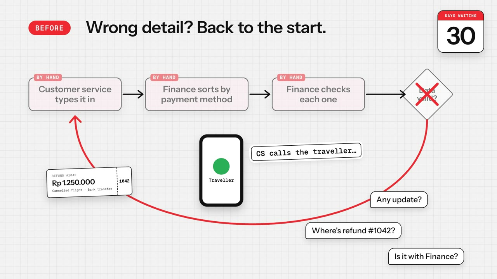
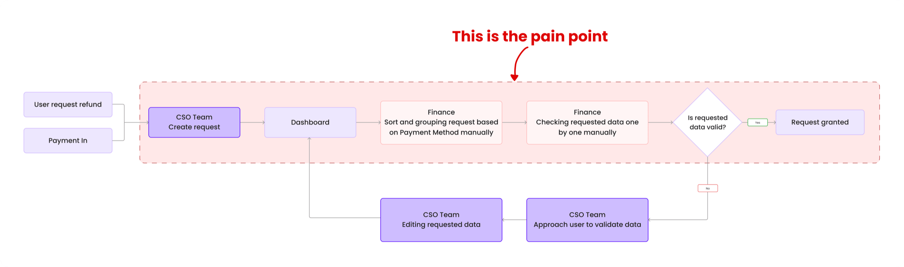
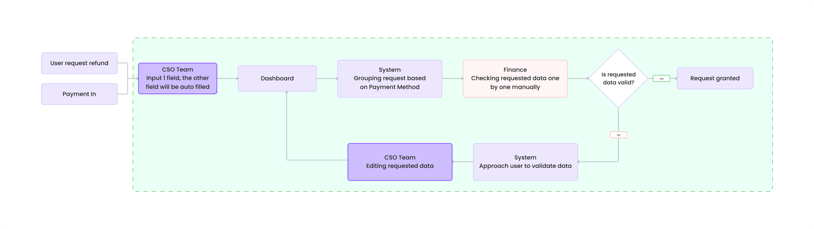
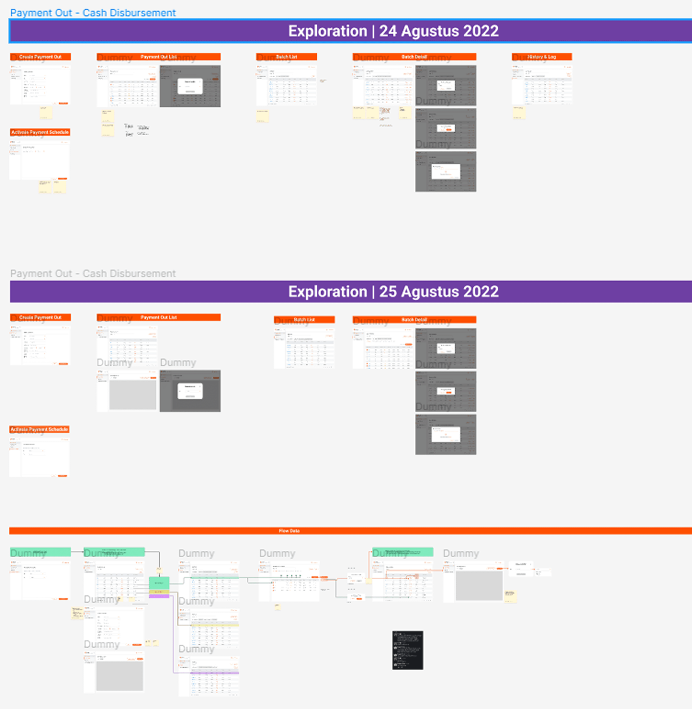
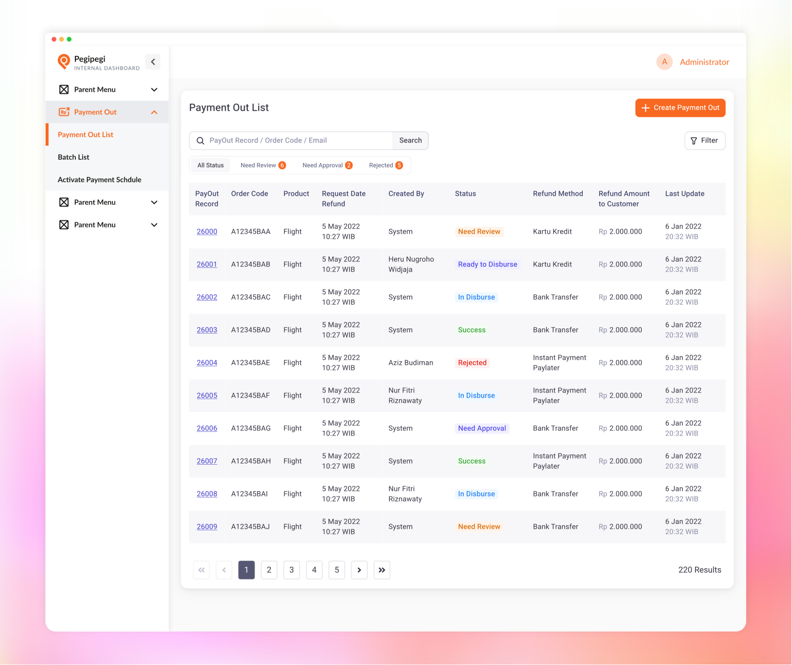

# Pegipegi Refunds: Cutting Refund Time From a Month to a Week

**Redesigning a manual back-office refund workflow with the Finance and Customer Service teams, so travellers get their money in about a week instead of a month (76% faster).**

[**Read the full case study →**](https://raam-portfolio-eta.vercel.app/work/pegipegi-refunds) · [Watch the 85-second video](https://raam-portfolio-eta.vercel.app/work/pegipegi-refunds#watch)

---

## Overview

| | |
|---|---|
| **Company** | Pegipegi, one of Indonesia's leading travel booking platforms (flights, hotels, trains) |
| **Role** | UX Designer, working with the PM, the Finance and Customer Service teams, and engineering |
| **Timeline** | 1.5 months, 2022 |
| **Users** | Internal: the Finance and Customer Service teams |
| **Methods** | Shadowing, interviews, process mapping, co-design sessions |
| **Outcome** | A refund reaches the traveller in about a week instead of about a month: **76% faster** |

---

## Why this mattered

A refund usually follows a cancelled flight, hotel or train: a moment when the traveller is already let down. Waiting **about a month** for their money turned one bad experience into two, and every slow refund meant more follow-up for the teams handling it.

The work behind each refund was almost entirely manual. That made it slow, and every manual step was another chance for a mistake.

The problem came to me from the PM: why does a refund take so long?

---

## Where the month went

There was no screen to redesign; it was a process. So I shadowed and interviewed the two teams who handled every refund, **Finance and Customer Service**, and mapped a single refund from request to payout.

**The delay wasn't one slow step. It was the manual work between the steps.**

- **Customer Service** created each refund request by hand, then contacted travellers to validate their details.
- **Finance** sorted and grouped the requests by payment method, then checked every request's data one by one before approving.
- If any detail was wrong, the request went all the way back to Customer Service, who had to contact the traveller again.
- Neither team could easily see where a refund was, so requests stalled between them.

---

## Three decisions

### 1. Let the system do the sorting

- **Context:** Finance spent its time grouping requests by payment method before any real checking started.
- **Instead of:** giving Finance a better spreadsheet or filters.
- **Why:** grouping follows fixed rules, so it doesn't need a person. Removing it frees Finance for the checks that do.
- **Result:** the new flow groups requests by payment method automatically.

### 2. Ask the traveller directly, not through a person

- **Context:** Customer Service had to contact travellers one by one to confirm their refund details.
- **Instead of:** adding a checklist to make the manual follow-up faster.
- **Why:** the traveller is the person who knows their details. Asking them directly removes a round trip between two people.
- **Result:** the system now contacts travellers to validate their data, a step that used to be manual.

### 3. One dashboard both teams share

- **Context:** refunds stalled because neither team could see where a request was.
- **Instead of:** separate tools for each team, with handoffs over chat.
- **Why:** a shared view of every refund and its status removes the "where is this one?" questions between teams.
- **Result:** a payment-out dashboard listing every refund, its status and the next action.

In the new process, Customer Service enters one field and the rest of the request fills itself in, the system groups requests by payment method, and the system asks travellers to confirm their own details. **Finance still checks each request**: the point was to remove the handwork between the steps, not the checks that matter.

---

## Getting both teams on board

Back-office changes fail when the people doing the work don't trust them. I ran brainstorming sessions with Finance, Customer Service and product, then took the design through **4 rounds of feedback** with the PM and both teams until everyone signed off.

---

## Impact

| | |
|---|---|
| **About 1 month → about 1 week** | for a refund to reach the traveller |
| **76%** | faster |

## What I'd do differently

- **Measure more than speed.** Tracking errors and refund-related contacts would show the full effect on both teams and travellers.
- **Treat internal tools like products.** The people using them every day are users too, and their speed becomes the customer's experience.

---

[Raam Pujangga Sadewa](https://raam-portfolio-eta.vercel.app) · Product Design Engineer
